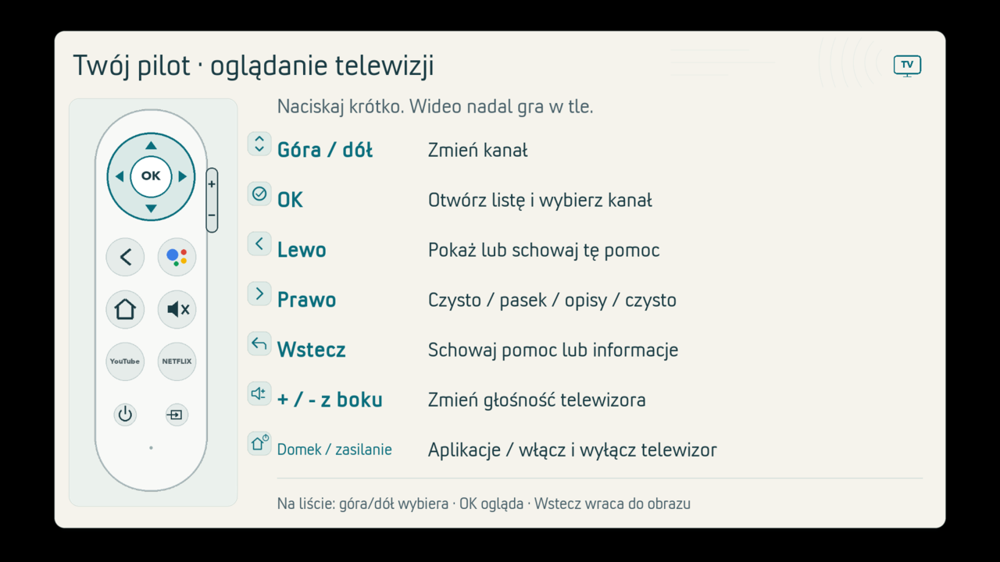
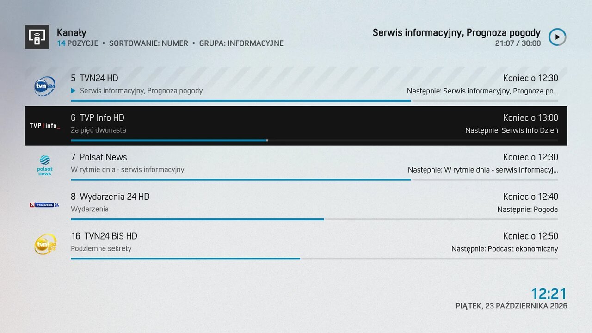
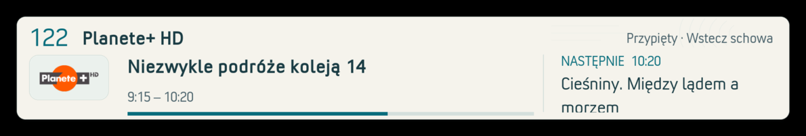

# Nasz TV — TV for my dad

[Polski](README.md)

My 72-year-old dad now watches TV on an old LG with a Chromecast HD, using the arrow buttons to change channels and OK to open his eight favourites.
Nasz TV is the collection of Kodi add-ons and settings I put together for him.

Have a similar setup? Start with the [installation guide](HUMAN.md), currently in Polish. This is a preview release; I haven't installed the public packages on a TV device yet.

The TV still worked, but the Orange app wouldn't play the channels from our paid
Start TV subscription. There were also too many menus and buttons to navigate.
I spent a few days working with AI to make the setup easier for Dad to use.

Now he's watching.

## On screen

These are real screenshots from our home setup.

News channels with programme titles and end times.

What's on now and next. In this test, pressing Back hid the banner without changing channels.
Cropped to the banner: the broadcast picture is protected and comes out black in screenshots.

## What Dad gets

- TV starts on the last channel he watched.
- Up and Down change channels. OK opens his eight favourites.
- The banner shows what's on now and what's coming next.
- Left opens a help screen with a picture of the remote.
- The “Nasz TV” tile on the Android home screen opens Kodi.

**Favourites editing and voice control are experimental.** The editor saves
changes to the list, but Dad hasn't used it himself yet. Back up your Kodi profile before trying it.
Choosing a channel by voice in Polish has worked, though not every time.
On a new device, installing the voice app alone won't enable channel switching.
The remote is still the way to watch day to day.

## Who it's for

If you'd like to make TV easier for yourself or someone close to you,
and you're comfortable installing and configuring a few add-ons, this is for you.

You'll need your own Orange TV subscription. I've tested the project on a Chromecast
with Google TV HD running Android 14; other devices remain untested.
Install Kodi 21 and the Arctic: Zephyr Reloaded skin separately;
the guide specifies versions 21.3 and 3.0.3, along with the required add-ons.

The packages don't include a subscription, channels, programme listings or login details.
Kodi, the full skin, libraries, fonts, station logos and DRM files aren't bundled either.
We watch through the unofficial OrangeGo add-on, using our own paid subscription.
You don't need a computer running to watch.

## Release status

> Preview release 2026.10.25. The features described here work on one home setup:
> Chromecast with Google TV HD, Android 14, Kodi 21.3,
> Arctic: Zephyr Reloaded 3.0.3 and Orange Start TV.
> I've checked the public packages only on a computer. I haven't installed them
> on the TV device yet, or tested them on a second unit.

Have a similar setup? [Tell me how it went in Issues](https://github.com/fiedoruk/404-tf-nasz-tv/issues).
Include your device model and software versions, but no login details.

## Getting started

1. Read the [step-by-step guide](HUMAN.md), currently in Polish. Start by backing up your Kodi profile.
2. Download the packages from [Releases](https://github.com/fiedoruk/404-tf-nasz-tv/releases/tag/v2026.10.25)
   and verify them against [SHA256SUMS](https://github.com/fiedoruk/404-tf-nasz-tv/releases/download/v2026.10.25/SHA256SUMS).
3. Before installing, check your setup against [the compatibility table](COMPATIBILITY.md)
   and read [the known limitations](BLOCKERS.md). Then follow the installation guide.

**For AI agents:** read [AGENT.md](AGENT.md) before helping with installation.

**For developers:** the code is in [src/](src/); [BUILD.md](BUILD.md) explains how to build the packages.

## The story and the remote

[Read the full story on 404.tf](https://404.tf/nasz-tv.html). The page is in Polish.
It has real screenshots and a remote demo you can try in your browser.
The demo uses a sample programme schedule, with no live TV stream.

## Licences

Original code: MIT. Original documentation and artwork: CC BY 4.0.  
OrangeGo: GPL-2.0. Arctic: Zephyr Reloaded adaptations: CC BY-NC-SA 3.0, for non-commercial use only.  
Scope and credits: [LICENSE](LICENSE), [NOTICE.md](NOTICE.md), [ATTRIBUTION.md](ATTRIBUTION.md).  
An independent project, with no affiliation with Orange, Google or Kodi.

Created by Tomasz Fiedoruk, [404.tf](https://404.tf/).
